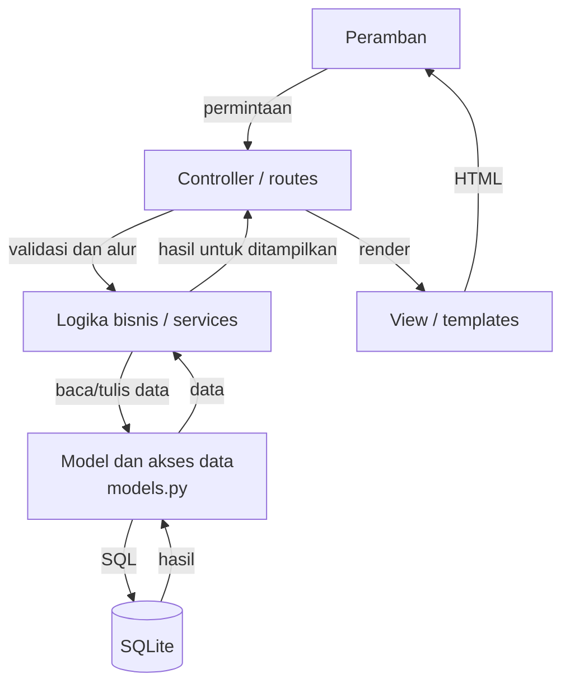

# Arsitektur aplikasi

> Rancangan awal untuk aplikasi pengelolaan resep. Framework web, bentuk autentikasi, dan penempatan basis data belum diputuskan. Diagram dan struktur berikut adalah usulan, bukan gambaran implementasi yang sudah ada.

## Diagram lapisan



## Struktur folder yang diusulkan

```text
app/
    __init__.py       Inisialisasi aplikasi dan konfigurasi.
    routes.py         Menerima permintaan HTTP dan memanggil layanan.
    services.py       Aturan bisnis dan validasi alur resep.
    models.py         Satu-satunya modul yang mengakses SQLite.
    templates/        Template halaman daftar, pencarian, dan rincian resep.
    static/           CSS, JavaScript, dan aset antarmuka.
instance/
    resep.db          Berkas basis data lokal; tidak dimasukkan ke Git.
docs/
    desain/           ERD, normalisasi, kamus data, dan rancangan skema.
tests/
    cek_skema.py      Uji batasan skema SQLite.
app.py                Titik masuk untuk menjalankan aplikasi.
```

## Tanggung jawab dan batas akses

- **Peramban/view:** menampilkan formulir, hasil pencarian, dan rincian resep; tidak mengakses basis data.
- **Routes/controller:** menerjemahkan permintaan menjadi pemanggilan layanan serta memilih respons/halaman.
- **Services:** memvalidasi aturan aplikasi dan mengorkestrasi operasi resep; tidak menjalankan SQL.
- **Models:** satu-satunya lapisan yang membuka koneksi atau menjalankan SQL SQLite.
- **SQLite:** menyimpan tabel sesuai [kamus data](./kamus-data.md) dan [skema](./schema.sql).

## Urutan modul Sprint 1

1. **Fondasi model resep dan skema** — tabel serta operasi baca/tulis melalui `models.py`; uji kendala.
2. **Pencatatan resep** — layanan dan formulir untuk menyimpan nama, bahan, dan langkah dengan validasi yang telah disepakati.
3. **Pencarian dan pembacaan resep** — daftar hasil, keadaan tanpa hasil, dan halaman rincian sesuai KF-02.

Framework, bidang pencarian, dan definisi atribut wajib masih perlu diputuskan sebelum implementasi.
